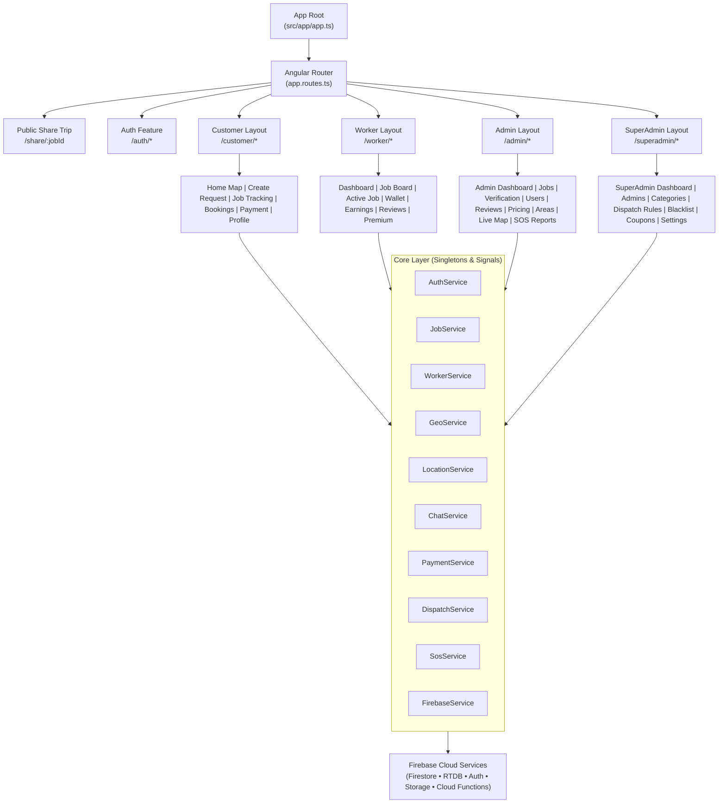

# 🧭 KajKhoj (কাজখোঁজ) — Complete Architecture & Component Map

> **Quick Navigation Guide for Developers & AI Agents**  
> Use this document to instantly pinpoint any bug or feature request to its exact component, service, or function in seconds. Clickable links take you straight to the source file.

---

## 📑 Table of Contents
1. [Tech Stack & Architecture Overview](#1-tech-stack--architecture-overview)
2. [High-Level Architecture Diagram](#2-high-level-architecture-diagram)
3. [Folder Structure Tree](#3-folder-structure-tree)
4. [Core Layer (`src/app/core/`)](#4-core-layer-srcappcore)
   - [Route Guards](#41-route-guards)
   - [Singleton Services](#42-singleton-services)
   - [Data Models & Types](#43-data-models--types)
   - [Interceptors & i18n](#44-interceptors--internationalization-i18n)
5. [Feature Modules (`src/app/features/`)](#5-feature-modules-srcappfeatures)
   - [Authentication Module (`/auth`)](#51-authentication-module-auth)
   - [Customer Module (`/customer`)](#52-customer-module-customer)
   - [Worker Module (`/worker`)](#53-worker-module-worker)
   - [Admin Module (`/admin`)](#54-admin-module-admin)
   - [SuperAdmin Module (`/superadmin`)](#55-superadmin-module-superadmin)
   - [Public Live Share Trip (`/share/:jobId`)](#56-public-live-share-trip-sharejobid)
6. [Layouts (`src/app/layouts/`)](#6-layouts-srcapplayouts)
7. [Shared Layer (`src/app/shared/`)](#7-shared-layer-srcappshared)
   - [Shared UI Components](#71-shared-ui-components)
   - [Shared Pipes](#72-shared-pipes)
8. [Firebase Backend Functions & Rules](#8-firebase-backend-functions--rules)
   - [Cloud Functions (`functions/src/`)](#81-firebase-cloud-functions)
   - [Security Rules (`firestore.rules`, `storage.rules`, `database.rules.json`)](#82-security-rules)
9. [⚡ Rapid Troubleshooting Matrix (Bug Finder)](#9--rapid-troubleshooting-matrix-bug-finder)

---

## 1. Tech Stack & Architecture Overview

- **Framework**: Angular 21 (Standalone Components, Signals, Computed properties, Inject API)
- **UI & Design**: PrimeNG 21 + PrimeFlex + PrimeIcons (Aura preset theme, Dark mode support)
- **Maps & Geolocation**: MapLibre GL 6.18 + `geofire-common` (Distance calculation, Geohash indexing)
- **Backend / Realtime**: Firebase 13 (Cloud Firestore, Realtime Database for live GPS, Firebase Auth, Cloud Storage, Firebase Cloud Functions)
- **State & Sync**: Angular Signals + `localStorage` fallback + HTML5 `BroadcastChannel` for multi-tab sync
- **Routing**: Lazy-loaded feature routes with functional guards (`authGuard`, `roleGuard`, `notBannedGuard`, `workerOnboardingGuard`)

---

## 2. High-Level Architecture Diagram



---

## 3. Folder Structure Tree

```text
online-home-service/
├── functions/                              — Firebase Cloud Functions backend
│   └── src/                                — TypeScript cloud functions source
├── public/                                 — Static assets & icons
├── scripts/                                — Maintenance scripts (e.g. seed-firestore.mjs)
└── src/
    ├── environments/                       — Environment configs (development & production)
    └── app/
        ├── app.config.ts                   — Global application config, PrimeNG providers & routes
        ├── app.routes.ts                   — Top-level root routing definitions & guards
        ├── app.ts                          — Root component hosting <router-outlet>
        ├── core/                           — Core infrastructure, singleton services & domain models
        │   ├── guards/                     — Functional route protection guards
        │   ├── i18n/                       — Bangla/English translation dictionaries & tokens
        │   ├── interceptors/               — HTTP error handling interceptors
        │   ├── models/                     — TypeScript data interfaces & entity definitions
        │   └── services/                   — Injectable business logic singletons
        ├── features/                       — Domain-specific feature modules
        │   ├── admin/                      — Operation Admin portal (jobs, verification, live map, SOS)
        │   ├── auth/                       — Authentication (login, customer & worker registration)
        │   ├── customer/                   — Customer portal (map browsing, booking, tracking, payment)
        │   ├── share-trip/                 — Public non-authenticated live tracking URL
        │   ├── superadmin/                 — Platform SuperAdmin portal (system settings, categories, rules)
        │   └── worker/                     — Service provider worker portal (job board, active job, wallet)
        ├── layouts/                        — Shell layouts wrapping role-specific pages
        │   ├── admin-layout/               — Sidebar + topbar layout for Operations Admin
        │   ├── customer-layout/            — Header + bottom nav layout for Customers
        │   └── worker-layout/              — Online toggle + bottom nav layout for Workers
        └── shared/                         — Reusable UI components and pipes
            ├── components/                 — Modals, badges, chat, uploader, star ratings
            └── pipes/                      — Bangla numbers, Taka currency, relative time, phone mask
```

---

## 4. Core Layer (`src/app/core/`)

### 4.1 Route Guards

| Guard | Path | What It Does | When to Check |
|---|---|---|---|
| `authGuard` | [auth.guard.ts](file:///C:/unversity/online-home-service/src/app/core/guards/auth.guard.ts) | Verifies user is authenticated via `AuthService.isAuthenticated()`; redirects to `/auth/login` | Login bypass or redirect issues |
| `notBannedGuard` | [not-banned.guard.ts](file:///C:/unversity/online-home-service/src/app/core/guards/not-banned.guard.ts) | Blocks access if user status is `banned` or `suspended`; displays penalty modal | Suspended/banned users still taking actions |
| `roleGuard` | [role.guard.ts](file:///C:/unversity/online-home-service/src/app/core/guards/role.guard.ts) | Checks `route.data.roles` against user role (`customer`, `worker`, `admin`, `superadmin`) | Unauthorized access or role permission 403 errors |
| `workerOnboardingGuard` | [worker-onboarding.guard.ts](file:///C:/unversity/online-home-service/src/app/core/guards/worker-onboarding.guard.ts) | Ensures worker has completed NID & skill verification before opening worker workspace | New worker stuck before dashboard or bypassing KYC |

---

### 4.2 Singleton Services

| Service | Path | Summary & Key Responsibilities | Primary Methods / Signals |
|---|---|---|---|
| `AuthService` | [auth.service.ts](file:///C:/unversity/online-home-service/src/app/core/services/auth.service.ts) | Manages authentication, user session persistence, demo login shortcuts, role signals | `currentUser`, `currentWorker`, `loginAsDemo()`, `logout()`, `setUser()` |
| `JobService` | [job.service.ts](file:///C:/unversity/online-home-service/src/app/core/services/job.service.ts) | Central state for all jobs, status transitions, cross-tab sync via BroadcastChannel | `jobs`, `createJob()`, `updateJobStatus()`, `incomingJobOfferSignal`, `getJobById()` |
| `WorkerService` | [worker.service.ts](file:///C:/unversity/online-home-service/src/app/core/services/worker.service.ts) | Manages worker profiles, online/busy status toggles, skills, ratings, verification state | `workers`, `toggleOnlineStatus()`, `getWorkerById()`, `updateWorkerProfile()` |
| `GeoService` | [geo.service.ts](file:///C:/unversity/online-home-service/src/app/core/services/geo.service.ts) | Distance computation with `geofire-common`, geohashing, and worker dispatch match scoring | `getDistanceKm()`, `getGeohash()`, `calculateWorkerScore()` |
| `LocationService` | [location.service.ts](file:///C:/unversity/online-home-service/src/app/core/services/location.service.ts) | Device GPS detection, reverse geocoding to Bengali address, real-time GPS tracking | `userLocation`, `detectCurrentPosition()`, `reverseGeocode()`, `startTracking()` |
| `DispatchService` | [dispatch.service.ts](file:///C:/unversity/online-home-service/src/app/core/services/dispatch.service.ts) | Smart dispatch algorithm, finding nearest eligible workers, cascade dispatch offer timeouts | `dispatchJob()`, `findMatchingWorkers()`, `sendJobOffer()`, `cancelDispatch()` |
| `PaymentService` | [payment.service.ts](file:///C:/unversity/online-home-service/src/app/core/services/payment.service.ts) | Payment calculations, coupons, bKash/Nagad mock gateway execution, invoice generation | `processPayment()`, `applyCoupon()`, `calculateBill()`, `verifyTransaction()` |
| `ChatService` | [chat.service.ts](file:///C:/unversity/online-home-service/src/app/core/services/chat.service.ts) | In-job realtime chat messaging, image and audio voice note upload handling | `getMessages()`, `sendMessage()`, `sendVoiceNote()`, `markAsRead()` |
| `SosService` | [sos.service.ts](file:///C:/unversity/online-home-service/src/app/core/services/sos.service.ts) | Emergency panic button logic, real-time alert dispatch to police/emergency contacts and Admin SOS desk | `triggerSOS()`, `getActiveAlerts()`, `resolveAlert()` |
| `ReviewService` | [review.service.ts](file:///C:/unversity/online-home-service/src/app/core/services/review.service.ts) | Customer and worker rating submissions, recalculating cumulative score, review flags | `submitReview()`, `getWorkerReviews()`, `flagReview()` |
| `WalletService` | [wallet.service.ts](file:///C:/unversity/online-home-service/src/app/core/services/wallet.service.ts) | Worker earnings ledger, pending balance, withdrawal requests to bKash/Nagad | `getBalance()`, `requestWithdrawal()`, `getTransactions()` |
| `AreaService` | [area.service.ts](file:///C:/unversity/online-home-service/src/app/core/services/area.service.ts) | Serviceable polygons, hubs, zones management, surge pricing area multipliers | `getAreas()`, `isLocationCovered()`, `updateAreaMultiplier()` |
| `CategoryService` | [category.service.ts](file:///C:/unversity/online-home-service/src/app/core/services/category.service.ts) | Master catalog of services (Electrician, Plumber, AC Repair, Cleaning, etc.) | `getCategories()`, `getCategoryById()`, `createCategory()` |
| `PricingService` | [pricing.service.ts](file:///C:/unversity/online-home-service/src/app/core/services/pricing.service.ts) | Pricing tiers, base fare, per-hour rate, night surge, commission percentage splits | `calculateEstimate()`, `getPricingMatrix()`, `updatePricing()` |
| `NotificationService` | [notification.service.ts](file:///C:/unversity/online-home-service/src/app/core/services/notification.service.ts) | Push notification sound triggers, in-app notification badge counts, message feed | `notifications`, `addNotification()`, `markAllAsRead()`, `playChime()` |
| `ToastService` | [toast.service.ts](file:///C:/unversity/online-home-service/src/app/core/services/toast.service.ts) | Global floating feedback toast notifications (success, error, warning, info) | `success()`, `error()`, `info()`, `warn()` |
| `ThemeService` | [theme.service.ts](file:///C:/unversity/online-home-service/src/app/core/services/theme.service.ts) | Dark mode / Light mode toggle state, applies `.dark-mode` class on `document.body` | `isDarkMode`, `toggleTheme()`, `setTheme()` |
| `AuditLogService` | [audit-log.service.ts](file:///C:/unversity/online-home-service/src/app/core/services/audit-log.service.ts) | SuperAdmin security audit logging for administrative actions (bans, rate changes) | `logAction()`, `getAuditLogs()` |
| `ReportService` | [report.service.ts](file:///C:/unversity/online-home-service/src/app/core/services/report.service.ts) | Dispute reports, fake profile reports, customer complaint investigation workflows | `submitReport()`, `getReports()`, `updateReportStatus()` |
| `SettingsService` | [settings.service.ts](file:///C:/unversity/online-home-service/src/app/core/services/settings.service.ts) | Global platform toggles (commission rate, auto-dispatch timeout, maintenance mode) | `getSettings()`, `updateSettings()` |
| `FirebaseService` | [firebase.service.ts](file:///C:/unversity/online-home-service/src/app/core/services/firebase.service.ts) | Direct wrapper for Firebase Auth, Firestore, and Realtime Database live references | `firestore`, `rtdb`, `auth`, `storage` |

---

### 4.3 Data Models & Types

| Model File | Path | Key Types & Entities Represented |
|---|---|---|
| `job.model.ts` | [job.model.ts](file:///C:/unversity/online-home-service/src/app/core/models/job.model.ts) | `Job`, `JobStatus` (12 states), `JobType` (instant, direct, scheduled, board_bid), `JobBid`, `ChatMessage` |
| `worker.model.ts` | [worker.model.ts](file:///C:/unversity/online-home-service/src/app/core/models/worker.model.ts) | `WorkerProfile`, `WorkerVerificationStatus`, `GeoPoint`, `WorkerTier`, `WorkerBadge` |
| `user.model.ts` | [user.model.ts](file:///C:/unversity/online-home-service/src/app/core/models/user.model.ts) | `User`, `UserRole` (`customer`, `worker`, `admin`, `superadmin`), `UserStatus` |
| `category.model.ts` | [category.model.ts](file:///C:/unversity/online-home-service/src/app/core/models/category.model.ts) | `ServiceCategory`, `SubCategory`, pricing rules, icon names, skill tags |
| `pricing.model.ts` | [pricing.model.ts](file:///C:/unversity/online-home-service/src/app/core/models/pricing.model.ts) | `PricingRule`, `FareCalculation`, platform commission rate, surge multipliers |
| `coupon.model.ts` | [coupon.model.ts](file:///C:/unversity/online-home-service/src/app/core/models/coupon.model.ts) | `Coupon`, discount percentages, max discount cap, expiry timestamp, usage count |
| `sos.model.ts` | [sos.model.ts](file:///C:/unversity/online-home-service/src/app/core/models/sos.model.ts) | `SosAlert`, triggering user coordinates, job snapshot, resolved status, emergency dispatch |
| `transaction.model.ts` | [transaction.model.ts](file:///C:/unversity/online-home-service/src/app/core/models/transaction.model.ts) | `Transaction`, wallet debits/credits, bKash transaction IDs, withdrawal status |
| `blacklist.model.ts` | [blacklist.model.ts](file:///C:/unversity/online-home-service/src/app/core/models/blacklist.model.ts) | `BlacklistEntry`, banned phone numbers, NID numbers, IP addresses, ban reasons |
| `audit-log.model.ts` | [audit-log.model.ts](file:///C:/unversity/online-home-service/src/app/core/models/audit-log.model.ts) | `AuditLogEntry`, admin actor UID, action taken, target resource, previous vs new values |

---

### 4.4 Interceptors & Internationalization (i18n)

- **Error Interceptor**: [error.interceptor.ts](file:///C:/unversity/online-home-service/src/app/core/interceptors/error.interceptor.ts) — Catches uncaught HTTP & network failures, routes user to login on 401 Unauthorized, displays error toast via `ToastService`.
- **i18n Index**: [i18n/index.ts](file:///C:/unversity/online-home-service/src/app/core/i18n/index.ts) — Bilingual (Bangla `bn` & English `en`) dictionary registry and helper signals for language switching across the entire platform.

---

## 5. Feature Modules (`src/app/features/`)

### 5.1 Authentication Module (`/auth`)
*Route Definition*: [auth.routes.ts](file:///C:/unversity/online-home-service/src/app/features/auth/auth.routes.ts)

| Component | Path | Route | Summary |
|---|---|---|---|
| `LoginComponent` | [login.component.ts](file:///C:/unversity/online-home-service/src/app/features/auth/login/login.component.ts) | `/auth/login` | Phone OTP & password authentication, one-click demo login buttons for all roles |
| `RegisterCustomerComponent` | [register-customer.component.ts](file:///C:/unversity/online-home-service/src/app/features/auth/register-customer/register-customer.component.ts) | `/auth/register-customer` | Customer sign-up form with phone verification and default location selection |
| `RegisterWorkerComponent` | [register-worker.component.ts](file:///C:/unversity/online-home-service/src/app/features/auth/register-worker/register-worker.component.ts) | `/auth/register-worker` | Multi-step worker onboarding with NID upload, skill category selection, experience entry |

---

### 5.2 Customer Module (`/customer`)
*Route Definition*: [customer.routes.ts](file:///C:/unversity/online-home-service/src/app/features/customer/customer.routes.ts)

| Component | Path | Route | Summary |
|---|---|---|---|
| `HomeMapComponent` | [home-map.component.ts](file:///C:/unversity/online-home-service/src/app/features/customer/home-map/home-map.component.ts) | `/customer/home` | MapLibre interactive map showing live workers, category cards, location search bar |
| `CreateRequestComponent` | [create-request.component.ts](file:///C:/unversity/online-home-service/src/app/features/customer/create-request/create-request.component.ts) | `/customer/create-request` | Step-by-step job order creator (instant or schedule, doorstep pin, photo upload, pricing estimate) |
| `SearchingWorkerComponent` | [searching-worker.component.ts](file:///C:/unversity/online-home-service/src/app/features/customer/searching-worker/searching-worker.component.ts) | `/customer/searching-worker/:id` | Animated radar search screen with auto-dispatch timeout countdown and retry mechanism |
| `JobTrackingComponent` | [job-tracking.component.ts](file:///C:/unversity/online-home-service/src/app/features/customer/job-tracking/job-tracking.component.ts) | `/customer/tracking/:id` | Realtime worker location tracking on map, ETA calculation, OTP start code, job chat |
| `CustomerPaymentComponent` | [customer-payment.component.ts](file:///C:/unversity/online-home-service/src/app/features/customer/payment/customer-payment.component.ts) | `/customer/payment/:id` | Invoice review, coupon application, bKash / Nagad / Cash payment selector, completion rating |
| `MyBookingsComponent` | [my-bookings.component.ts](file:///C:/unversity/online-home-service/src/app/features/customer/my-bookings/my-bookings.component.ts) | `/customer/bookings` | Filterable list of past and active bookings (Pending, In Progress, Completed, Cancelled) |
| `CustomerProfileComponent` | [customer-profile.component.ts](file:///C:/unversity/online-home-service/src/app/features/customer/profile/customer-profile.component.ts) | `/customer/profile` | Manage customer name, saved addresses, emergency contacts, language, and theme |
| `WorkerProfilePageComponent` | [worker-profile-page.component.ts](file:///C:/unversity/online-home-service/src/app/features/customer/worker-profile/worker-profile-page.component.ts) | `/customer/worker-profile/:id` | Public worker portfolio page with verified badge, reviews list, rating distribution, direct hire button |

---

### 5.3 Worker Module (`/worker`)
*Route Definition*: [worker.routes.ts](file:///C:/unversity/online-home-service/src/app/features/worker/worker.routes.ts)

| Component | Path | Route | Summary |
|---|---|---|---|
| `WorkerDashboardComponent` | [worker-dashboard.component.ts](file:///C:/unversity/online-home-service/src/app/features/worker/dashboard/worker-dashboard.component.ts) | `/worker/dashboard` | Main worker cockpit: Online/Offline switch, daily earnings gauge, incoming job radar alerts |
| `WorkerActiveJobComponent` | [worker-active-job.component.ts](file:///C:/unversity/online-home-service/src/app/features/worker/active-job/worker-active-job.component.ts) | `/worker/active/:id` | Active job workflow: Navigation to customer, OTP verification, job timer, complete job button |
| `WorkerJobBoardComponent` | [worker-job-board.component.ts](file:///C:/unversity/online-home-service/src/app/features/worker/job-board/worker-job-board.component.ts) | `/worker/job-board` | Open marketplace for broadcasted tasks where workers can submit custom price bids |
| `WorkerWalletComponent` | [worker-wallet.component.ts](file:///C:/unversity/online-home-service/src/app/features/worker/wallet/worker-wallet.component.ts) | `/worker/wallet` | Balance ledger, commission deduction logs, withdrawal form to bKash/Nagad accounts |
| `WorkerEarningsComponent` | [worker-earnings.component.ts](file:///C:/unversity/online-home-service/src/app/features/worker/earnings/worker-earnings.component.ts) | `/worker/earnings` | Weekly and monthly earnings visual charts, completion rates, performance metrics |
| `WorkerJobHistoryComponent` | [worker-job-history.component.ts](file:///C:/unversity/online-home-service/src/app/features/worker/job-history/worker-job-history.component.ts) | `/worker/job-history` | Archive of completed and cancelled jobs with customer reviews and payout status |
| `WorkerReviewsComponent` | [worker-reviews.component.ts](file:///C:/unversity/online-home-service/src/app/features/worker/reviews/worker-reviews.component.ts) | `/worker/reviews` | Feedback wall showing customer stars, written comments, and badge achievements |
| `WorkerEditProfileComponent` | [worker-edit-profile.component.ts](file:///C:/unversity/online-home-service/src/app/features/worker/edit-profile/worker-edit-profile.component.ts) | `/worker/edit-profile` | Update profile picture, skills list, service zones, and NID documents |
| `WorkerPremiumComponent` | [worker-premium.component.ts](file:///C:/unversity/online-home-service/src/app/features/worker/premium/worker-premium.component.ts) | `/worker/premium` | Pro tier subscription purchase (priority dispatch boost, zero commission perks) |

---

### 5.4 Admin Module (`/admin`)
*Route Definition*: [admin.routes.ts](file:///C:/unversity/online-home-service/src/app/features/admin/admin.routes.ts)

| Component | Path | Route | Summary |
|---|---|---|---|
| `AdminDashboardComponent` | [admin-dashboard.component.ts](file:///C:/unversity/online-home-service/src/app/features/admin/dashboard/admin-dashboard.component.ts) | `/admin/dashboard` | KPI analytics: Active jobs, total revenue, online worker count, daily volume |
| `AdminJobsComponent` | [admin-jobs.component.ts](file:///C:/unversity/online-home-service/src/app/features/admin/jobs/admin-jobs.component.ts) | `/admin/jobs` | Realtime table of all platform jobs, force cancellation, reassign worker actions |
| `AdminWorkerVerificationComponent` | [admin-workers.component.ts](file:///C:/unversity/online-home-service/src/app/features/admin/workers/admin-workers.component.ts) | `/admin/verification` | KYC document approval queue: Review worker NID card photo, background checks, approve/reject |
| `AdminUsersListComponent` | [admin-users.component.ts](file:///C:/unversity/online-home-service/src/app/features/admin/users/admin-users.component.ts) | `/admin/users` | Master directory of customers and workers with search, balance adjustment, and ban controls |
| `AdminLiveMapComponent` | [admin-live-map.component.ts](file:///C:/unversity/online-home-service/src/app/features/admin/live-map/admin-live-map.component.ts) | `/admin/live-map` | God-view live map displaying all online workers, active trips, and cluster heatmaps |
| `AdminReportsComponent` | [admin-reports.component.ts](file:///C:/unversity/online-home-service/src/app/features/admin/reports/admin-reports.component.ts) | `/admin/reports` | SOS Emergency Control Room and user dispute resolution tickets |
| `AdminTransactionsComponent` | [admin-transactions.component.ts](file:///C:/unversity/online-home-service/src/app/features/admin/transactions/admin-transactions.component.ts) | `/admin/transactions` | Financial audit of all platform transactions, approve or decline worker withdrawal requests |
| `AdminPricingMatrixComponent` | [admin-pricing.component.ts](file:///C:/unversity/online-home-service/src/app/features/admin/pricing/admin-pricing.component.ts) | `/admin/pricing` | Manage base fare, per km rate, hourly rates, and peak surge multipliers |
| `AdminAreasComponent` | [admin-areas.component.ts](file:///C:/unversity/online-home-service/src/app/features/admin/areas/admin-areas.component.ts) | `/admin/areas` | Define service hubs (Dhanmondi, Gulshan, Uttara, Mirpur, Savar) and boundary geofences |
| `AdminReviewsComponent` | [admin-reviews.component.ts](file:///C:/unversity/online-home-service/src/app/features/admin/reviews/admin-reviews.component.ts) | `/admin/reviews` | Review moderation, remove inappropriate comments, inspect abusive rating reports |

---

### 5.5 SuperAdmin Module (`/superadmin`)
*Route Definition*: [superadmin.routes.ts](file:///C:/unversity/online-home-service/src/app/features/superadmin/superadmin.routes.ts)

| Component | Path | Route | Summary |
|---|---|---|---|
| `SuperadminDashboardComponent` | [superadmin-dashboard.component.ts](file:///C:/unversity/online-home-service/src/app/features/superadmin/dashboard/superadmin-dashboard.component.ts) | `/superadmin/dashboard` | Executive level metrics, platform profit breakdown, server health, system error logs |
| `SuperadminAdminsComponent` | [superadmin-admins.component.ts](file:///C:/unversity/online-home-service/src/app/features/superadmin/admins/superadmin-admins.component.ts) | `/superadmin/admins` | Grant, edit, delete and suspend Admin staff roles with bilingual controls and toast feedback |
| `SuperadminCategoriesComponent` | [superadmin-categories.component.ts](file:///C:/unversity/online-home-service/src/app/features/superadmin/categories/superadmin-categories.component.ts) | `/superadmin/categories` | Complete categories CRUD: add, edit, update, delete, order, and toggle active status |
| `SuperadminDispatchComponent` | [superadmin-dispatch.component.ts](file:///C:/unversity/online-home-service/src/app/features/superadmin/dispatch/superadmin-dispatch.component.ts) | `/superadmin/dispatch` | Configure dispatch engine weights: distance vs rating vs accept rate vs premium boost |
| `SuperadminBlacklistComponent` | [superadmin-blacklist.component.ts](file:///C:/unversity/online-home-service/src/app/features/superadmin/blacklist/superadmin-blacklist.component.ts) | `/superadmin/blacklist` | Permanent platform blacklisting by NID number, phone number, or device identifier |
| `SuperadminCouponsComponent` | [superadmin-coupons.component.ts](file:///C:/unversity/online-home-service/src/app/features/superadmin/coupons/superadmin-coupons.component.ts) | `/superadmin/coupons` | Create, edit, update and delete promotional discount codes, validity dates, maximum discount limits |
| `SuperadminAuditLogsComponent` | [superadmin-audit-logs.component.ts](file:///C:/unversity/online-home-service/src/app/features/superadmin/audit-logs/superadmin-audit-logs.component.ts) | `/superadmin/audit-logs` | Immutable audit trail tracking every staff modification, ban, and transaction approval |
| `SuperadminSettingsComponent` | [superadmin-settings.component.ts](file:///C:/unversity/online-home-service/src/app/features/superadmin/settings/superadmin-settings.component.ts) | `/superadmin/settings` | Platform global toggles (system maintenance mode, commission %, contact phone) |
| `SuperadminLayoutComponent` | [superadmin-layout.component.ts](file:///C:/unversity/online-home-service/src/app/features/superadmin/superadmin-layout/superadmin-layout.component.ts) | `/superadmin` (Shell) | Dedicated dark sidebar shell for the SuperAdmin control center |

---

### 5.6 Public Live Share Trip (`/share/:jobId`)

| Component | Path | Route | Summary |
|---|---|---|---|
| `ShareTripComponent` | [share-trip.component.ts](file:///C:/unversity/online-home-service/src/app/features/share-trip/share-trip.component.ts) | `/share/:jobId` | Public unauthenticated web view allowing friends/family to track worker arrival in real time for safety |

---

## 6. Layouts (`src/app/layouts/`)

| Layout | Path | Summary & Shell Elements |
|---|---|---|
| `CustomerLayoutComponent` | [customer-layout.component.ts](file:///C:/unversity/online-home-service/src/app/layouts/customer-layout/customer-layout.component.ts) | Main top navbar with Logo, SOS emergency button, Notification bell, Language switch, Avatar menu; mobile sticky bottom navigation |
| `WorkerLayoutComponent` | [worker-layout.component.ts](file:///C:/unversity/online-home-service/src/app/layouts/worker-layout/worker-layout.component.ts) | Dedicated worker top bar with online/offline toggle switch, active earnings pill, incoming job offer dialog listener, worker bottom bar |
| `AdminLayoutComponent` | [admin-layout.component.ts](file:///C:/unversity/online-home-service/src/app/layouts/admin-layout/admin-layout.component.ts) | Desktop collateral sidebar with navigation links to Dashboard, Verification, Jobs, Map, SOS Control Room, and user profile header |

---

## 7. Shared Layer (`src/app/shared/`)

### 7.1 Shared UI Components

| Component | Path | Purpose & Functionality |
|---|---|---|
| `JobChatComponent` | [job-chat.component.ts](file:///C:/unversity/online-home-service/src/app/shared/components/job-chat/job-chat.component.ts) | Full in-job chat drawer supporting instant messaging, image attachments, and voice notes |
| `DoorstepPinPickerComponent` | [doorstep-pin-picker.component.ts](file:///C:/unversity/online-home-service/src/app/shared/components/doorstep-pin-picker/doorstep-pin-picker.component.ts) | Mini-map selector allowing customer to pin exact building entrance or doorstep |
| `NotificationCenterComponent` | [notification-center.component.ts](file:///C:/unversity/online-home-service/src/app/shared/components/notification-center/notification-center.component.ts) | Notification drawer with sound alerts, read/unread status, and direct route navigation |
| `WorkerCardComponent` | [worker-card.component.ts](file:///C:/unversity/online-home-service/src/app/shared/components/worker-card/worker-card.component.ts) | Reusable worker profile preview card with badge, rating, hourly price, and hire button |
| `WorkerProfileDialogComponent` | [worker-profile-dialog.component.ts](file:///C:/unversity/online-home-service/src/app/shared/components/worker-profile-dialog/worker-profile-dialog.component.ts) | Modal popup displaying complete worker biography, reviews, and portfolio pictures |
| `RatingStarsComponent` | [rating-stars.component.ts](file:///C:/unversity/online-home-service/src/app/shared/components/rating-stars/rating-stars.component.ts) | Star rating selector and display component (supports interactive voting or readonly) |
| `StatusBadgeComponent` | [status-badge.component.ts](file:///C:/unversity/online-home-service/src/app/shared/components/status-badge/status-badge.component.ts) | Color-coded status badge for jobs (`accepted`, `in_progress`, `completed`, `cancelled`) |
| `ImageUploaderComponent` | [image-uploader.component.ts](file:///C:/unversity/online-home-service/src/app/shared/components/image-uploader/image-uploader.component.ts) | Drag-and-drop image file uploader with preview thumbnail and validation |
| `SkeletonLoaderComponent` | [skeleton-loader.component.ts](file:///C:/unversity/online-home-service/src/app/shared/components/skeleton-loader/skeleton-loader.component.ts) | Reusable shimmer skeleton placeholders for cards, tables, and maps during loading |
| `ConfirmDialogComponent` | [confirm-dialog.component.ts](file:///C:/unversity/online-home-service/src/app/shared/components/confirm-dialog/confirm-dialog.component.ts) | Generic confirmation prompt modal for destructive actions (cancel job, ban user) |
| `EmptyStateComponent` | [empty-state.component.ts](file:///C:/unversity/online-home-service/src/app/shared/components/empty-state/empty-state.component.ts) | Displays friendly illustration and text when lists (bookings, reviews, jobs) are empty |
| `LangToggleComponent` | [lang-toggle.component.ts](file:///C:/unversity/online-home-service/src/app/shared/components/lang-toggle/lang-toggle.component.ts) | Clean toggle button to instantly switch interface language between Bangla and English |

---

### 7.2 Shared Pipes

| Pipe | Path | Example Transformation |
|---|---|---|
| `BnNumberPipe` | [bn-number.pipe.ts](file:///C:/unversity/online-home-service/src/app/shared/pipes/bn-number.pipe.ts) | `1234` ➔ `'১২৩৪'` (Converts English numbers to Bangla digits) |
| `TakaPipe` | [taka.pipe.ts](file:///C:/unversity/online-home-service/src/app/shared/pipes/taka.pipe.ts) | `500` ➔ `'৳ ৫০০'` (Formats number as Bangladeshi Taka currency) |
| `TimeAgoPipe` | [time-ago.pipe.ts](file:///C:/unversity/online-home-service/src/app/shared/pipes/time-ago.pipe.ts) | ISO Date ➔ `'৫ মিনিট আগে'` (Human readable relative timestamp) |
| `MaskPhonePipe` | [mask-phone.pipe.ts](file:///C:/unversity/online-home-service/src/app/shared/pipes/mask-phone.pipe.ts) | `'01712345678'` ➔ `'017****5678'` (Protects privacy until job is accepted) |
| `TranslatePipe` | [translate.pipe.ts](file:///C:/unversity/online-home-service/src/app/shared/pipes/translate.pipe.ts) | `'common.login'` ➔ `'লগইন'` (Translates keys via i18n dictionary) |

---

## 8. Firebase Backend Functions & Rules

### 8.1 Firebase Cloud Functions
*Root*: [functions/src/index.ts](file:///C:/unversity/online-home-service/functions/src/index.ts)

| File | Path | Exported Cloud Functions | Summary |
|---|---|---|---|
| `dispatch.ts` | [dispatch.ts](file:///C:/unversity/online-home-service/functions/src/dispatch.ts) | `onJobCreated`, `acceptJob`, `grabBoardJob`, `submitBid`, `chooseBid`, `updateJobStatus`, `completeJob`, `cancelJob` | Core state machine managing job lifecycle, finding nearby workers, dispatch cascade timeouts |
| `payments.ts` | [payments.ts](file:///C:/unversity/online-home-service/functions/src/payments.ts) | `paymentWebhook`, `requestWithdraw` | Secure server-side payment callback processing and worker withdrawal handling |
| `reviews.ts` | [reviews.ts](file:///C:/unversity/online-home-service/functions/src/reviews.ts) | `submitReview`, `banUser`, `unbanUser` | Rating calculations, updating worker cumulative rating score, user ban management |
| `safety.ts` | [safety.ts](file:///C:/unversity/online-home-service/functions/src/safety.ts) | `triggerSOS`, `approveWorker`, `rejectWorker` | Emergency SOS distribution, staff KYC approval and worker rejection notifications |
| `schedulers.ts` | [schedulers.ts](file:///C:/unversity/online-home-service/functions/src/schedulers.ts) | `autoOfflineStaleWorkers`, `liftExpiredSuspensions`, `dailyReport` | Automated cron jobs: switches inactive workers offline after 15m, lifts temporary bans |

---

### 8.2 Security Rules

| Rules File | Path | What It Protects |
|---|---|---|
| `firestore.rules` | [firestore.rules](file:///C:/unversity/online-home-service/firestore.rules) | Enforces role-based read/write access to Firestore collections (`users`, `jobs`, `workers`, `transactions`, `reviews`, `settings`). Prevents customers from modifying prices or job statuses directly. |
| `storage.rules` | [storage.rules](file:///C:/unversity/online-home-service/storage.rules) | Restricts Cloud Storage file uploads: NID documents accessible only to Admin and owner; chat images and voice notes restricted to job participants. |
| `database.rules.json` | [database.rules.json](file:///C:/unversity/online-home-service/database.rules.json) | Realtime Database rules for live GPS coordinates (`/workers_live/{workerId}`), ensuring only the authenticated worker can write their GPS location. |

---

## 9. ⚡ Rapid Troubleshooting Matrix (Bug Finder)

When an issue is reported, locate the symptom in the table below to immediately identify the target file to edit:

| # | Problem / Feature Symptom | Primary File(s) to Check | What to Inspect / Fix |
|---|---|---|---|
| 1 | **Login fails or user cannot switch roles in demo** | [auth.service.ts](file:///C:/unversity/online-home-service/src/app/core/services/auth.service.ts)<br>[login.component.ts](file:///C:/unversity/online-home-service/src/app/features/auth/login/login.component.ts) | Inspect `loginAsDemo()` method, verify `defaultUsers` UID match in SeedData |
| 2 | **Customer cannot access worker page or receives 403** | [role.guard.ts](file:///C:/unversity/online-home-service/src/app/core/guards/role.guard.ts)<br>[app.routes.ts](file:///C:/unversity/online-home-service/src/app/app.routes.ts) | Check `route.data.roles` array in `app.routes.ts` or user's `role` property in `AuthService` |
| 3 | **Worker stuck or cannot access dashboard after registration** | [worker-onboarding.guard.ts](file:///C:/unversity/online-home-service/src/app/core/guards/worker-onboarding.guard.ts) | Check worker `verificationStatus` — must be `'verified'` or bypassed in demo |
| 4 | **Map does not render or shows blank canvas** | [home-map.component.ts](file:///C:/unversity/online-home-service/src/app/features/customer/home-map/home-map.component.ts)<br>[environment.ts](file:///C:/unversity/online-home-service/src/environments/environment.ts) | Check MapLibre container ID, CSS height, and style URL in `environment.map.tileUrl` |
| 5 | **Worker marker not appearing on map** | [location.service.ts](file:///C:/unversity/online-home-service/src/app/core/services/location.service.ts)<br>[worker.service.ts](file:///C:/unversity/online-home-service/src/app/core/services/worker.service.ts) | Check worker `isOnline: true` flag and whether valid lat/lng coordinates are set |
| 6 | **Wrong distance calculation or incorrect fare estimate** | [geo.service.ts](file:///C:/unversity/online-home-service/src/app/core/services/geo.service.ts)<br>[pricing.service.ts](file:///C:/unversity/online-home-service/src/app/core/services/pricing.service.ts) | Verify `distanceBetween()` calculation in `GeoService` and `baseFare + (km * ratePerKm)` |
| 7 | **Job request created but no worker receives notification** | [job.service.ts](file:///C:/unversity/online-home-service/src/app/core/services/job.service.ts)<br>[dispatch.service.ts](file:///C:/unversity/online-home-service/src/app/core/services/dispatch.service.ts) | Inspect `incomingJobOfferSignal`, check `BroadcastChannel` cross-tab message dispatch |
| 8 | **Worker accepts job but status does not change to `accepted`** | [job.service.ts](file:///C:/unversity/online-home-service/src/app/core/services/job.service.ts)<br>[dispatch.ts](file:///C:/unversity/online-home-service/functions/src/dispatch.ts) | Look for `updateJobStatus(jobId, 'accepted')` and check localStorage persistence |
| 9 | **Live tracking does not update worker location** | [job-tracking.component.ts](file:///C:/unversity/online-home-service/src/app/features/customer/job-tracking/job-tracking.component.ts)<br>[database.rules.json](file:///C:/unversity/online-home-service/database.rules.json) | Check Firebase Realtime Database subscription on `/workers_live/{workerId}` |
| 10 | **OTP code verification fails during job start** | [worker-active-job.component.ts](file:///C:/unversity/online-home-service/src/app/features/worker/active-job/worker-active-job.component.ts)<br>[job.model.ts](file:///C:/unversity/online-home-service/src/app/core/models/job.model.ts) | Verify `job.otp` (4-digit code) matches between customer tracking page and worker input |
| 11 | **Payment page does not apply coupon discount** | [payment.service.ts](file:///C:/unversity/online-home-service/src/app/core/services/payment.service.ts)<br>[customer-payment.component.ts](file:///C:/unversity/online-home-service/src/app/features/customer/payment/customer-payment.component.ts) | Check coupon code validity, minimum bill requirement, and expiry date logic |
| 12 | **Worker wallet balance not updating after job completion** | [wallet.service.ts](file:///C:/unversity/online-home-service/src/app/core/services/wallet.service.ts)<br>[payments.ts](file:///C:/unversity/online-home-service/functions/src/payments.ts) | Check net payout formula: `totalAmount * (1 - platformCommissionRate)` |
| 13 | **Chat messages not sending or appearing out of order** | [chat.service.ts](file:///C:/unversity/online-home-service/src/app/core/services/chat.service.ts)<br>[job-chat.component.ts](file:///C:/unversity/online-home-service/src/app/shared/components/job-chat/job-chat.component.ts) | Inspect `messages` signal array and timestamp ordering in `sendMessage()` |
| 14 | **Audio voice note recording or playback failing** | [job-chat.component.ts](file:///C:/unversity/online-home-service/src/app/shared/components/job-chat/job-chat.component.ts) | Check browser `navigator.mediaDevices.getUserMedia` permission and Blob upload logic |
| 15 | **SOS Emergency button not alerting Admin desk** | [sos.service.ts](file:///C:/unversity/online-home-service/src/app/core/services/sos.service.ts)<br>[admin-reports.component.ts](file:///C:/unversity/online-home-service/src/app/features/admin/reports/admin-reports.component.ts) | Check `SosService.triggerSOS()` and ensure `AdminReportsComponent` subscribes to alerts |
| 16 | **Admin KYC approval does not reflect on worker status** | [admin-workers.component.ts](file:///C:/unversity/online-home-service/src/app/features/admin/workers/admin-workers.component.ts)<br>[worker.service.ts](file:///C:/unversity/online-home-service/src/app/core/services/worker.service.ts) | Inspect `approveWorker()` method updating `verificationStatus: 'verified'` |
| 17 | **Public share trip link (`/share/:jobId`) asks for login** | [app.routes.ts](file:///C:/unversity/online-home-service/src/app/app.routes.ts)<br>[share-trip.component.ts](file:///C:/unversity/online-home-service/src/app/features/share-trip/share-trip.component.ts) | Ensure `/share/:jobId` route has NO `canActivate` guards attached in `app.routes.ts` |
| 18 | **Bangla numbers displaying as English digits** | [bn-number.pipe.ts](file:///C:/unversity/online-home-service/src/app/shared/pipes/bn-number.pipe.ts) | Verify template uses `{{ value \| bnNumber }}` pipe |
| 19 | **Dark mode not toggling or styles not applying** | [theme.service.ts](file:///C:/unversity/online-home-service/src/app/core/services/theme.service.ts)<br>[app.config.ts](file:///C:/unversity/online-home-service/src/app/app.config.ts) | Ensure `darkModeSelector: '.dark-mode'` matches class added to `document.documentElement` |
| 20 | **Notification audio chime not playing** | [notification.service.ts](file:///C:/unversity/online-home-service/src/app/core/services/notification.service.ts) | Check browser autoplay policies or audio file path in `/public/sounds/chime.mp3` |
| 21 | **SuperAdmin cannot edit commission or platform settings** | [superadmin-settings.component.ts](file:///C:/unversity/online-home-service/src/app/features/superadmin/settings/superadmin-settings.component.ts)<br>[settings.service.ts](file:///C:/unversity/online-home-service/src/app/core/services/settings.service.ts) | Inspect `updateSettings()` in `SettingsService` and check `isSuperAdmin()` check |
| 22 | **Worker bidding on Job Board does not show up for customer** | [worker-job-board.component.ts](file:///C:/unversity/online-home-service/src/app/features/worker/job-board/worker-job-board.component.ts)<br>[create-request.component.ts](file:///C:/unversity/online-home-service/src/app/features/customer/create-request/create-request.component.ts) | Check `job.bids` array mutation in `JobService.submitBid()` and localStorage saving |
| 23 | **Favorite worker not deleting or reappearing after removal** | [auth.service.ts](file:///C:/unversity/online-home-service/src/app/core/services/auth.service.ts)<br>[customer-layout.component.ts](file:///C:/unversity/online-home-service/src/app/layouts/customer-layout/customer-layout.component.ts)<br>[customer-profile.component.ts](file:///C:/unversity/online-home-service/src/app/features/customer/profile/customer-profile.component.ts) | Use idempotent `removeFavoriteWorker()`, sync to Firestore & seedData defaultUsers, preserve localStorage across logins |
| 24 | **Delete action confirmation modal** | [app.config.ts](file:///C:/unversity/online-home-service/src/app/app.config.ts)<br>[app.html](file:///C:/unversity/online-home-service/src/app/app.html)<br>[superadmin-admins.component.ts](file:///C:/unversity/online-home-service/src/app/features/superadmin/admins/superadmin-admins.component.ts)<br>[superadmin-categories.component.ts](file:///C:/unversity/online-home-service/src/app/features/superadmin/categories/superadmin-categories.component.ts)<br>[superadmin-coupons.component.ts](file:///C:/unversity/online-home-service/src/app/features/superadmin/coupons/superadmin-coupons.component.ts) | PrimeNG `ConfirmationService` + `<p-confirmdialog>` for consistent delete confirmations |
| 25 | **Table horizontal scrollbar / responsive wrapping** | [superadmin-admins.component.scss](file:///C:/unversity/online-home-service/src/app/features/superadmin/admins/superadmin-admins.component.scss)<br>[superadmin-coupons.component.scss](file:///C:/unversity/online-home-service/src/app/features/superadmin/coupons/superadmin-coupons.component.scss) | Remove fixed large min-widths, use compact action buttons, hide intrusive scrollbars with `scrollbar-width: none` |

---

> **Tip for Agents**: When solving any bug in this codebase, first search this document for the feature keyword. Open the linked file directly, locate the relevant method, make the minimal surgical fix, and test.
